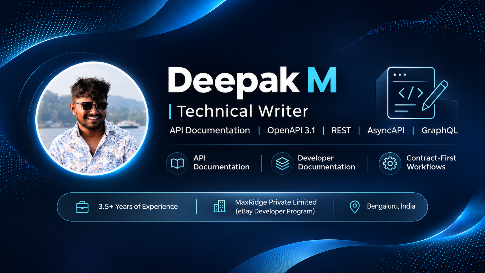

 

  

<h1 align="center">Hi there! 👋 I'm Deepak M</h1>

<h3 align="center">Technical Writer | API Documentation | OpenAPI 3.1 | REST | AsyncAPI | GraphQL</h3>

  
  
  

---

## 👨‍💻 About Me

I'm a **Technical Writer with 3.5+ years of experience** specializing in API documentation, developer documentation, structured technical content, and contract-first documentation workflows.

Currently, I'm working with **MaxRidge Private Limited**, supporting the **eBay Developer Program**. My primary focus is transforming complex API specifications and engineering requirements into accurate, structured, and developer-friendly documentation.

My expertise includes:

- 📘 Creating and maintaining REST API documentation using **OpenAPI Specification (OAS 3.1)**.
- 🔗 Working with **AsyncAPI specifications** and event-driven notification documentation.
- 🧩 Documenting **GraphQL schemas, queries, mutations, types, and API workflows**.
- 📄 Migrating legacy API documentation to contract-based documentation workflows.
- 🔍 Reviewing JSON/YAML specifications, schema definitions, references, required fields, enums, and error responses.
- 🛠️ Managing developer portal content, CMS publishing, and QA-to-production documentation workflows.
- 🤝 Collaborating with software engineers, product managers, SMEs, QA teams, and documentation reviewers.
- ☁️ Applying a **DevOps and cloud background** (AWS, Docker, Kubernetes, Terraform, CI/CD) to document developer platforms accurately.
- ✍️ Developing user guides, installation manuals, SOPs, release notes, and technical procedures.

**My goal:** Bridging the gap between complex engineering concepts and clear, reliable, developer-friendly documentation.

---

## 🧑‍💼 Professional Experience

### 🏢 MaxRidge Private Limited
**Technical Writer – API Documentation | eBay Developer Program**

📅 February 2026 – Present  
📍 Bengaluru, Karnataka, India

Supporting the creation, migration, review, and publication of API and developer documentation for the eBay Developer Program.

**Key Responsibilities:**

- Migrate legacy REST API documentation to contract-based documentation using Service Design Documents (SDDs) and OpenAPI 3.1 specifications.
- Review OpenAPI JSON/YAML contracts, including service, domain, generated, staging, merged, and CMS-ready specifications.
- Compare source and generated specifications to identify missing descriptions, unexpected schemas, incorrect types, duplicate definitions, and generation issues.
- Author and maintain API overviews, methods, parameters, response fields, schemas, enumerations, HTTP headers, OAuth scopes, code samples, and release notes.
- Validate required request fields and always-returned response fields through schema-level `required` definitions.
- Conduct QA and production documentation reviews to ensure consistency in method order, links, formatting, status codes, errors, enums, and samples.
- Document event-driven notifications using AsyncAPI specifications.
- Review GraphQL schemas covering analytics, rate limits, bulk data transfer thresholds, and related API types.
- Maintain developer portal content, including landing pages, guides, notification pages, redirects, HTML, and API groupings.
- Support QA-to-production documentation publishing and release workflows.
- Collaborate with engineers, product managers, SMEs, QA teams, and reviewers using Jira, GitHub, Slack, and Confluence.
- Prepare technical presentations and demonstrations covering SDD-to-OAS conversion, OpenAPI validation, specification comparison, CMS deployment, and production readiness.

**API Domains:** Buy, Sell, Commerce, Notifications, Analytics, Account, Translation, Logistics, Fulfillment, Finance, Stores, Marketing, Browse, and Marketplace APIs.

### 🏢 Hoder Solutions Private Limited
**Technical Writer**

📅 May 2023 – February 2026  
📍 Bengaluru, Karnataka, India

**Key Responsibilities:**

- Created and maintained user guides, installation manuals, API documentation, SOPs, internal procedures, and release notes.
- Developed structured technical content using DITA/XML, Adobe FrameMaker, and Oxygen XML Editor.
- Documented API workflows, deployment procedures, product functionality, and internal engineering processes.
- Collaborated with developers, SMEs, QA engineers, and product managers to gather technical information and validate documentation.
- Created annotated screenshots, workflows, and step-by-step instructions using SnagIt.
- Implemented documentation templates, writing standards, and structured-content practices.
- Conducted technical reviews and maintained version-controlled content.
- Ensured documentation consistency, readability, and compliance with style guides and content governance requirements.

---

## 🚀 Key Projects — eBay Developer Program

### 1️⃣ GraphQL Listing API Guides
- Wrote and restructured the **Listing Creation** and **Listing Management** guides, including API use cases, `createListing` mutation walkthroughs for single- and multi-SKU listings, and CMS-ready code samples.
- Defined API ordering across the Listing, Inventory, Sell Feed, and Trading APIs in guide introductions.
- Validated field names against the supergraph so only supported fields are documented.

🔗 [Listing Creation](https://developer.ebay.com/develop/guides/sell/listing-creation) · [Listing Management](https://developer.ebay.com/develop/guides/sell/listing-management)

### 2️⃣ Modern APIs Migration Guide (Trading API → REST & GraphQL)
- Updated the guide that maps Trading API calls, Post-Order methods, and Platform Notifications to their REST/GraphQL replacements, including Listing API migration differences.
- Repaired CMS table structures and revalidated links against schemas and rendered pages.

🔗 [Modern APIs Migration Guide](https://developer.ebay.com/develop/guides/sell/modern-apis-migration-guide)

### 3️⃣ GraphQL Rate Limits, App Insights & Developer Analytics APIs
- Documented per-operation GraphQL rate limits on the API Call Limits pages for Sell and Buy APIs.
- Wrote App Insights API content (`applicationApiRateLimits`, `userApiRateLimits`, `bulkDataTransferThresholds`) and Developer Analytics rate-limit methods (`getRateLimits`, `getUserRateLimits`).
- Verified content from QA through production.

🔗 [API Call Limits](https://developer.ebay.com/develop/get-started/api-call-limits) · [App Insights API](https://developer.ebay.com/develop/api/sell/app_insights_api_)

### 4️⃣ Commerce Feedback API (OpenAPI)
- Updated the OpenAPI specification for `getFeedback` and `getFeedbackRatingSummary`.
- Audited engineering requirements for request vs. response period semantics (30/180/365-day filters), `excludeRepeatFeedback` behavior, and related error codes.

🔗 [Feedback API](https://developer.ebay.com/develop/api/sell/feedback_api)

---

## 🛠️ Technical Skills

### 📘 API & Developer Documentation

- API Reference Documentation
- OpenAPI Specification (OAS 3.1)
- REST API Documentation
- AsyncAPI Specifications
- GraphQL Documentation
- Contract-First Documentation
- Service Design Documents (SDD)
- JSON & YAML Specifications
- API Schema Documentation
- Request & Response Documentation
- OAuth Scopes and Error Documentation
- Developer Guides and Release Notes

### 📄 Technical Writing

- User Guides
- Installation Manuals
- Standard Operating Procedures (SOPs)
- Structured Authoring
- DITA/XML
- Technical Editing
- Information Architecture
- Content Governance
- Documentation Quality Assurance

### 🧰 Documentation Tools & Platforms

- Oxygen XML Editor
- Adobe FrameMaker
- MadCap Flare
- SnagIt
- Postman
- Jira
- GitHub
- Confluence
- Slack
- Content Management Systems (CMS)

### ☁️ DevOps, Cloud & Technology Foundation

- AWS Cloud, Azure, Cloud Computing
- Docker, Kubernetes, OpenShift
- Jenkins, Terraform, Ansible (CI/CD & Infrastructure as Code)
- Git, Linux
- Prometheus, Grafana
- Python, Java
- JSON, YAML
- HTML & CSS, JavaScript

### 🔄 Methodologies

- Agile
- Scrum
- Waterfall
- Collaborative Documentation Reviews
- Documentation Governance
- Release Management

---

## 🎓 Education

### 🎓 Master of Computer Applications (MCA)
**Cloud Computing**

JAIN (Deemed-to-be University), Bengaluru  
📅 September 2023 – October 2025

### 🎓 Bachelor of Science (BSc)
**Computer Science**

Government Science College, Bengaluru  
📅 March 2018 – April 2023

---

## 📜 Certifications

- Technical Writing: Quick Start Guides
- Agile and Lean Foundations
- AWS Cloud Practitioner
- JavaScript Course – Unlocking the Power of JavaScript
- Introduction to Programming Using Python

---

## 🌍 Languages

- English
- Kannada
- Hindi
- Telugu

---

## 🤝 Connect With Me

  
  
  
  

---

  <i>"Turning complex technology into clear, meaningful documentation."</i>

  Thanks for visiting my GitHub profile! ⭐

